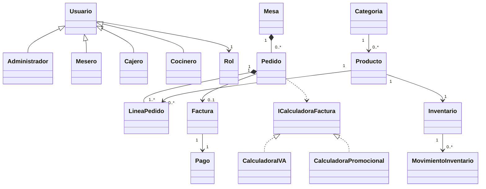

# A2. Diagrama de clases

La fuente editable está en `02-diagrama-clases.mmd` y la imagen exportada en `02-diagrama-clases.svg`.

| Clase | Atributos principales | Métodos principales |
|---|---|---|
| Usuario | idUsuario: Long, nombre: String, correo: String, estado: boolean | iniciarSesion(), cerrarSesion() |
| Administrador | permisos: Set~String~ | gestionarUsuarios(), gestionarRoles() |
| Mesero | turno: String | registrarPedido(), consultarEstado() |
| Cajero | cajaAsignada: String | generarFactura(), procesarPago() |
| Cocinero | estacion: String | actualizarEstadoPedido() |
| Rol | idRol: Long, nombre: String, permisos: Set~String~ | autorizar(accion: String) |
| Mesa | idMesa: Long, numero: int, estado: String | cambiarEstado(), consultarConsumo() |
| Pedido | idPedido: Long, fechaHora: LocalDateTime, estado: String | confirmar(), cancelar(), enviarCocina() |
| LineaPedido | cantidad: int, observacion: String, precioRegistrado: BigDecimal | calcularSubtotal() |
| Producto | idProducto: Long, nombre: String, precio: BigDecimal | actualizarDisponibilidad() |
| Categoria | idCategoria: Long, nombre: String | listarProductos() |
| Inventario | cantidadActual: int, cantidadMinima: int | ajustar(), verificarMinimo() |
| MovimientoInventario | idMovimiento: Long, tipo: String, cantidad: int | registrar() |
| Factura | idFactura: Long, total: BigDecimal | calcular(), emitir() |
| Pago | idPago: Long, metodo: String, monto: BigDecimal | confirmar(), reversar() |
| ICalculadoraFactura | calcular(pedido: Pedido): BigDecimal | interfaz de estrategia |
| CalculadoraIVA | tasa: BigDecimal | calcular(pedido: Pedido): BigDecimal |
| CalculadoraPromocional | descuento: BigDecimal | calcular(pedido: Pedido): BigDecimal |
