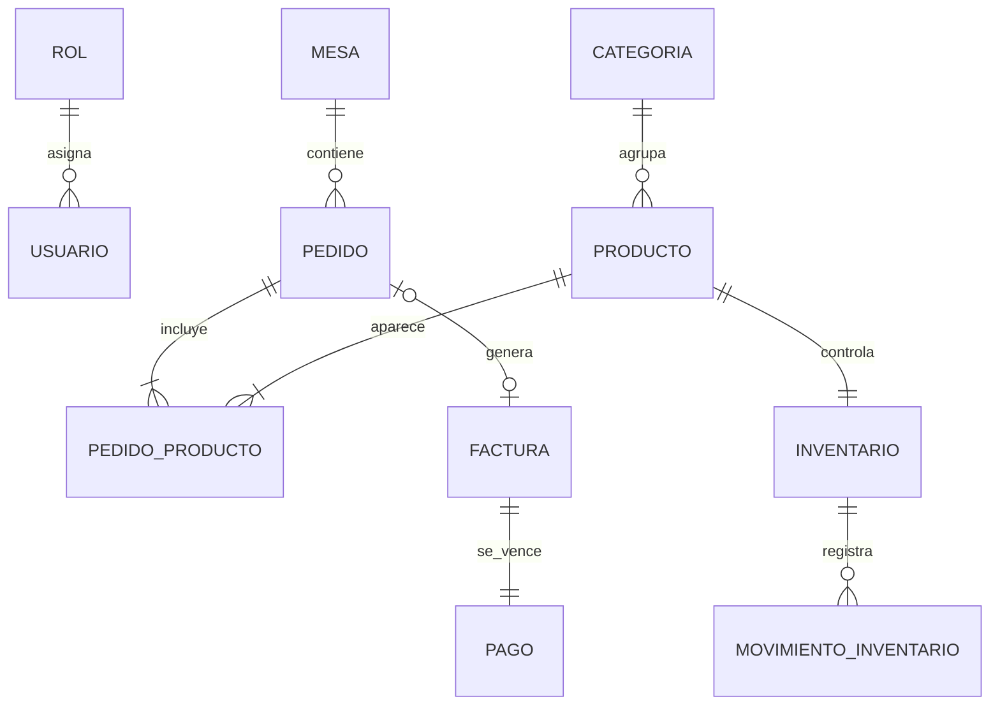

# B1. Modelo conceptual SIGRES

## Entidades

| Entidad | Identificador | Atributos |
|---|---|---|
| Usuario | id_usuario | nombre, correo, estado |
| Rol | id_rol | nombre, descripcion |
| Mesa | id_mesa | numero, capacidad, estado |
| Pedido | id_pedido | fecha_hora, estado, comensales |
| PedidoProducto | id_pedido, id_producto | cantidad, precio_unitario, observacion |
| Producto | id_producto | nombre, precio, disponibilidad |
| Categoria | id_categoria | nombre, descripcion |
| Inventario | id_inventario | cantidad_actual, cantidad_minima |
| MovimientoInventario | id_movimiento | fecha_hora, tipo, cantidad |
| Factura | id_factura | numero_consecutivo, fecha_hora, total |
| Pago | id_pago | metodo, monto, estado |
| ReporteVentas | id_reporte | periodo_inicio, periodo_fin, total |

## Relaciones

| Relación | Cardinalidad mínima/máxima | Participación |
|---|---|---|
| Rol-Usuario | 1:1..* desde Rol; Usuario tiene 1 Rol | Rol parcial, Usuario total |
| Mesa-Pedido | Mesa 1:0..*, Pedido 0..*:1 Mesa | Mesa parcial, Pedido total |
| Pedido-PedidoProducto | 1:1..*; N:M con Producto | Pedido y PedidoProducto totales |
| Producto-PedidoProducto | 1:0..*; N:M con Pedido | Producto y PedidoProducto totales |
| Categoria-Producto | 1:0..* | Categoria parcial, Producto total |
| Producto-Inventario | 1:1 | Ambos totales |
| Inventario-Movimiento | 1:0..* | Inventario total, movimiento total |
| Pedido-Factura | 1:0..1 | Pedido parcial, Factura total |
| Factura-Pago | 1:1 | Ambos totales |

